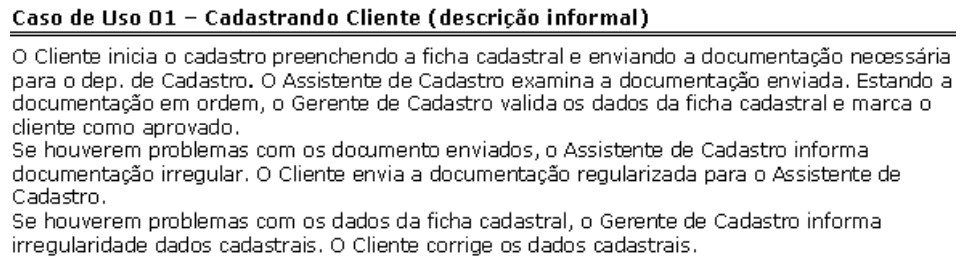

Preciso transformar uma descrição inicial de sistema em um documento de requisitos enxuto para apoiar toda a modelagem UML do projeto.

Objetivo: produzir uma especificação objetiva (apenas o necessário) para servir como base para Diagramas de Casos de Uso e de Componentes.

Gere a resposta em Markdown.

Expanda a descrição fornecida e assuma o papel de analista de requisitos. Não invente funcionalidades sem justificativa (Importante: não invente algo muito além do escopo sugerido, apenas complemente pra deixar redondo); quando fizer suposições, deixe explícito que são premissas do projeto. Utilize como base as melhores práticas do mercado nessa área.

## Adendos do professor (orientações adicionais, valem sobre o restante)

- **Diagrama de Casos de Uso:** focar apenas nos **principais** casos de uso — **uns 4**. Não modelar todas as funcionalidades do sistema.
- **Diagrama de Componentes:** entregar **dois níveis**:
    - **Geral (macro):** visão de todos os componentes do sistema e suas interfaces/dependências;
    - **Micro (detalhado):** um diagrama para **cada componente principal**, mostrando os **componentes internos** dele (componentes dos componentes).
- **Cobertura mínima nos uns 4 casos de uso:** escolhê-los de forma que, juntos, contemplem atores principais e secundários, generalização, `<<include>>` e `<<extend>>`.
- **Simplicidade:** requisitos e demais artefatos devem ser **bem simples e objetivos**; não é necessário detalhar demais (poucas regras, poucos fluxos, sem excesso de variações).

Aqui temos as instruções dadas pelo professor:

# Tema Escoolhido:

## Site de Loja de Eletrônicos (E-commerce)

- **Requisitos Básicos:** O sistema deve permitir que clientes naveguem por um catálogo de produtos (com filtros por categoria, marca, preço), adicionem itens a um carrinho de compras e finalizem pedidos. Deve haver integração com gateways de pagamento e cálculo de frete. O sistema também precisa de um módulo administrativo para gerenciar estoques, cadastrar produtos e acompanhar o status dos pedidos.

# Objetivo do Trabalho

O objetivo deste trabalho é aplicar os conceitos práticos de UML (Unified Modeling Language) através da elaboração de Diagramas de Casos de Uso e Diagramas de Componentes. Os alunos deverão escolher um dos quatro temas propostos abaixo para desenvolver a modelagem, compreendendo os requisitos do sistema e mapeando suas funcionalidades e arquitetura.

# Regras e Diretrizes para o Desenvolvimento

O trabalho deve ser entregue contendo os dois diagramas e suas respectivas documentações. Atente-se às regras de modelagem exigidas para cada um:

# PARTE 1: Diagrama de Casos de Uso

O diagrama de casos de uso deve oferecer uma visão clara das funcionalidades do sistema sob a perspectiva do usuário. O modelo deve obrigatoriamente conter:

- Fronteira do Sistema: Delimitar claramente o escopo do que está sendo modelado (caixa de contorno com o nome do sistema).
- Elementos do Diagrama:
    - Atores: Identificar atores principais (usuários diretos) e atores secundários (sistemas externos, gateways de pagamento, etc.).
    - Casos de Uso: Representar as funcionalidades principais (ex: "Realizar Compra", "Cadastrar Viagem").
- Relacionamentos:
    - Associação: Comunicação direta entre o ator e o caso de uso.
    - Generalização: Aplicada a atores (ex: "Usuário VIP" herdando de "Usuário Comum") ou casos de uso.
    - Dependência (<<include>> e <<extend>>): Utilizar obrigatoriamente inclusão (para passos obrigatórios/reutilizáveis, ex: "Autenticar Usuário") e extensão (para fluxos alternativos/opcionais).
- Documentação Textual (Especificação):
    - Para cada caso de uso modelado, deve ser criada uma breve descrição contendo: Nome do Caso de Uso e uma Descrição Textual resumida de sua funcionalidade e objetivo no sistema.

    

# PARTE 2: Diagrama de Componentes

O diagrama de componentes deve representar a estrutura arquitetural do sistema, mostrando como as partes do software estão organizadas e como se comunicam. O modelo deve obrigatoriamente conter:

- Componentes Lógicos/Físicos: Representar os módulos principais do sistema (ex: MóduloDePagamento, InterfaceWeb, BancoDeDados, MotorDeBusca).
- Interfaces Fornecidas e Requeridas:
    - Interfaces Fornecidas (Provided): Representadas pelo símbolo de "pirulito" (lollipop), mostrando os serviços que o componente oferece aos demais.
    - Interfaces Requeridas (Required): Representadas pelo símbolo de soquete (socket), mostrando os serviços que o componente precisa de outros para funcionar.
- Relacionamentos de Dependência: Mostrar claramente através de setas tracejadas quando um componente depende do funcionamento ou compilação de outro (ou de uma interface específica).
- Portas (Ports) - Opcional/Recomendado: Utilizar portas para demonstrar os pontos de interação encapsulados dos componentes com o ambiente externo.
- Organização: Se o sistema for complexo, agrupar os componentes em pacotes/subsistemas (ex: Frontend, Backend, Serviços Externos) para facilitar a leitura da arquitetura.

# Entregáveis do Trabalho

Os alunos deverão organizar as entregas em dois artefatos principais: um Documento de Projeto (PDF) e os Arquivos Fontes da Modelagem.

1. Documento de Projeto (Formato PDF) Este documento deve conter toda a especificação do trabalho e ser estruturado da seguinte forma:

- Capa e Identificação: Nome dos componentes do grupo, matrícula e tema escolhido.

- Visão Geral do Sistema: Um parágrafo resumindo o escopo do tema selecionado e os principais requisitos compreendidos pelo grupo.

- Seção de Casos de Uso:
    - Imagem do Diagrama de Casos de Uso (com boa resolução e legibilidade).
    - Especificação Textual: Para cada caso de uso modelado no diagrama, incluir uma tabela ou texto contendo:
        - Nome do Caso de Uso
        - Atores Envolvidos
        - Pré-condições
        - Fluxo Principal (passo a passo de sucesso)
        - Fluxos Alternativos ou de Exceção (quando aplicável, como erros de validação).

- Seção de Componentes (Projeto Arquitetural):
    - Imagens dos Diagramas de Componentes: o **geral** e um **micro** para cada componente principal (componentes internos).
    - Dicionário de Componentes: Uma breve lista descrevendo a responsabilidade de cada componente desenhado (geral e internos dos micros) e justificando suas dependências e interfaces requeridas/fornecidas.

2. Arquivos Fontes da Ferramenta de Modelagem Para garantir a autoria e permitir a conferência detalhada, o grupo deve entregar os arquivos editáveis gerados pela ferramenta de modelagem escolhida (Exemplos: arquivos .asta do Astah, .mdj do StarUML, .xml do Draw.io, ou o link de compartilhamento se for utilizado o Lucidchart).

3. Lista de símbolos.  Algumas plataformas, utilizam símbolos diferentes para representar a mesma informação. No trabalho, coloquem uma tabela com a lista de símbolos utilizados pela ferramenta escolhida. Citem também a ferramenta utilizada

**Formato de Submissão:** Os artefatos (PDF e Arquivos Fontes) podem ser compactados em um único arquivo .zip e submetidos no ambiente virtual de aprendizagem até a data limite estipulada. O arquivo deve ser nomeado no padrão: Tema_NomeDoGrupo.zip. Em caso de envio em arquivos separados, enviar no formato: GRUPOxx - NOME DO TEMA - TIPO DO ARQUIVO (ex: Grupo1 - tema XPTO - Diagrama de componente)

## OBSERVAÇÕES:

- Todos os membros devem enviar o trabalho final, sob penalização da nota individual.
    - Envios em atraso também acarretará penalidade na nota individual.
- Devem enviar nesta atividade a versão final do projeto. Em caso de envio incompleto ou diferente do que for mostrado durante as apresentações, o grupo sofrerá penalização de 40% sobre a nota coletiva.
- Será mantida a regra de presença mínima de 70% do grupo no dia da apresentação.